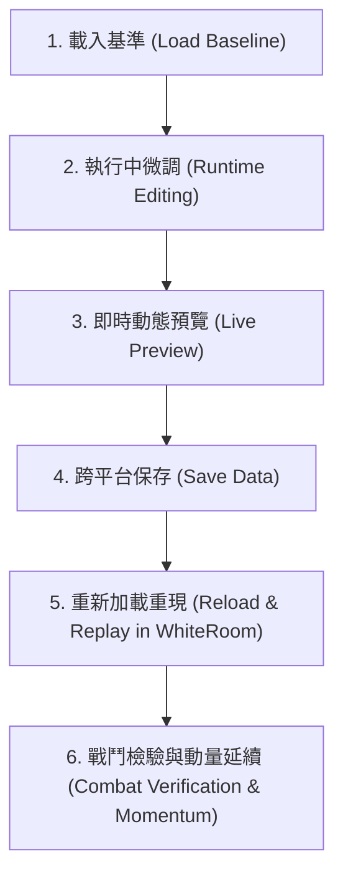

# WhiteRoom：動作往返、即時微調與動量保留測試案例

> 執行項目：`white-room-stage0` › `motion-roundtrip-cases`  
> 基準日期：2026-10-25  
> 整理依據：[WhiteRoom 實作計畫](../Implementation-Plan.md)、[Character Animation 計畫](../../../../Character-Animation/plan.md)、[既有能力對照](../Existing-Capabilities.md) 與已確認 UX 規格  
> 限制約定：純唯讀整理，不自訂資料結構、不預設 API 實作、不私自回答待決決策。

---

## 1. 整理背景與核心目標

在 WhiteRoom 的第一個可操作交付中，動作系統不僅要支援常規 3D PvE 戰鬥（移動、跳躍、攻擊、防禦與受擊），同時肩負驗證**跨平台資料驅動動作製作管線**的責任。

依據使用者在 `Implementation-Plan.md` 與 `Character-Animation/plan.md` 的明確約定：
1. **動作資料跨平台與去引擎化**：製作與播放不依賴 FBX 或 Unity 專屬二進位 `.anim` Clip，採用人類與 agent 皆友善的跨平台資料表達。
2. **兩路動作測試共用操作流**：首輪「固定人形骨架（簡單幾何外殼）」與後續「獨立肢體系統（LimbSystem）」已確認共用同一套姿態調整、預覽、保存與重載流程。
3. **受力因果與動量保留**：動作切換、受擊或中斷時，原有速度與受力衝量不得突兀被歸零，需具備物理動量保留機制。

本文件將已確認的 UX 需求整理為具備「前置條件、輸入與操作、可觀察預期結果、驗收證據」的標準測試案例表，並釐清固定骨架與肢體系統之差異邊界，最後列出仍待決的平台與資料格式問題。

---

## 2. 兩路動作測試的共通操作流程 (Shared Workflow)

固定人形骨架與獨立肢體系統在 WhiteRoom 中測試時，遵循完全相同的六步驟操作流程：

1. **載入基準 (Load Baseline)**：載入角色骨架拓撲與預設動作序列。
2. **執行中微調 (Runtime Editing)**：在選定的製作介面中，針對關鍵幀的肢體姿態（旋轉/位置/筋肉數值）與動作時序（前搖/判定/後搖區間）進行動態調整。
3. **即時動態預覽 (Live Preview)**：微調數值時，3D 視口立即反映姿態變化或循環播放效果，無須重新編譯或等待導出。
4. **跨平台保存 (Save Data)**：將調整後的動作與時序資料保存為獨立於 Unity 的結構化資料。
5. **重新加載重現 (Reload & Replay in WhiteRoom)**：WhiteRoom 宿主載入該資料，驅動 3D 測試角色精準重現該動作。
6. **戰鬥檢驗與動量延續 (Combat Verification & Momentum)**：在 WhiteRoom 的 PvE 實戰中檢驗該招式的出招判定、防禦反應及中斷時的動量保留。

---

## 3. 首輪固定骨架 vs 後續獨立肢體系統 (LimbSystem) 差異與邊界

| 比較向度 | 首輪方式：固定人形骨架（簡單外殼） | 後續方式：獨立肢體系統 (LimbSystem) |
|---|---|---|
| **骨架結構 (Skeleton)** | **固定 Humanoid 拓撲**：預定義的關節階層與人體自由度（頭、胸、雙臂、雙腿）。 | **動態拓撲 (Dynamic Topology)**：非人形骨架、樹枝狀、多肢體或程序化生長關節。 |
| **網格與外觀 (Mesh)** | **固定幾何外殼**：由 agent 預先製作的素面白幾何外觀與深色關節，預先綁定權重。 | **程序化生成 (Markup & Procedural Mesh)**：由肢體系統依據描述語言動態生成表面網格。 |
| **資料語意 (Data Semantics)** | 標準化人形筋肉數值（Muscles $[-1, 1]$）或本地關節旋轉。 | 肢體段落長度、生長方向、生長曲線與自訂節點約束。 |
| **首交驗證責任** | **首交必要範圍**：驗證完整的 PvE 循環與動作調整往返閉環。 | **首交非必要條件**：保留後續擴充接用介面，不阻礙首輪 PvE 交付。 |
| **歸屬與邊界** | 屬於 CombatAesthetic / WhiteRoom 首輪整合與驗證範圍。 | 屬於獨立 `Yu5h1Lib/LimbSystem`（或相關獨立計畫），WhiteRoom 僅作為消費端測試場。 |

---

## 4. 動作往返與微調測試案例表 (Test Cases)

### 案例 1：固定骨架姿勢即時調整與 Live Preview

* **前置條件**：製作介面（Web 或 3D Viewer）已啟動，載入素面白色機械人形基礎模型與待調整動作。
* **輸入與操作**：
  1. 選定攻擊或防禦動作之特定關鍵影格（如右手刺拳最高點）。
  2. 拖曳關節旋轉軸滑桿或人形筋肉（Muscle）數值（例如調大右肩前屈角度與小臂內旋角度）。
* **可觀察預期結果**：
  1. 3D 視窗中的角色立即更新右手姿態，無可感知的卡頓或延遲。
  2. 關節旋轉維持在人體極限約束內，無肢體翻轉或拉伸破圖現象。
* **證據記錄方式**：微調前後之 3D 視窗截圖／畫面記錄，以及對應骨架參數數值差異對照。

---

### 案例 2：動作時序（Timing）調整與循環預覽

* **前置條件**：角色處於攻擊動作連續播放預覽狀態。
* **輸入與操作**：
  1. 在時間軸介面上調整動作區間標記：將前搖（Startup）由 0.2s 縮短為 0.1s，將命中判定窗（Active Window）延長 0.05s。
  2. 勾選循環播放（Loop Preview）。
* **可觀察預期結果**：
  1. 角色出招動作節奏立即加快，出拳爆發感增強。
  2. 命中有效判定指示（如外框或關節標示）隨調整後的判定窗精準亮起與熄滅。
* **證據記錄方式**：時間軸標記數值記錄，以及調整後循環播放的幀率與時序日誌。

---

### 案例 3：跨平台資料保存與版本完整性

* **前置條件**：案例 1 與案例 2 之姿勢與時序已微調完成。
* **輸入與操作**：
  1. 執行介面中的「保存 (Save / Export)」操作。
  2. 指定或預設寫入目標動作資料檔案。
* **可觀察預期結果**：
  1. 產出獨立於引擎的跨平台資料檔（無 `.anim` 二進位依賴，無 UnityEditor 綁定）。
  2. 檔案內容完整包含：版本號、作者／修改者資訊（Agent / Human）、時間戳記、關鍵幀姿態數值與時序標記。
  3. 保存過程不鎖死檔案，可供外部程式或 WhiteRoom 立即讀取。
* **證據記錄方式**：保存產出之檔案路徑、檔案雜湊值（SHA256）及內容結構摘要。

---

### 案例 4：WhiteRoom 執行期加載重載與動作重現 (Roundtrip Replay)

* **前置條件**：Unity WhiteRoom 測試場處於執行中（PlayMode 或 Windows 執行版），角色位於白色空間中央。
* **輸入與操作**：
  1. 在 WhiteRoom 中觸發「重新載入動作資料 (Reload Motion Data)」指令（熱重載或重設情境）。
  2. 按下對應攻擊鍵觸發該招式。
* **可觀察預期結果**：
  1. WhiteRoom 角色執行該攻擊動作時，右肩前屈姿態、出招速度與判定窗完全與案例 1、2 在製作介面中調整的結果一致。
  2. 足部與地面保持貼合（`GroundIKTarget` 生效），骨盆自然維持重心（`BalanceHipController` 生效）。
* **證據記錄方式**：WhiteRoom 實機運行截圖／畫面，以及執行期載入日誌（動作名稱、版本、載入耗時）。

---

### 案例 5：動作中斷與動量延續 (Momentum Preservation on Interrupt)

* **前置條件**：玩家控制角色處於帶有向前衝刺突進（Lunge）的攻擊動作中，角色正以最大瞬時速度前衝。
* **輸入與操作**：
  * **情境 A（主動取消）**：在允許取消窗內按下 Space（閃避/跳躍）或右鍵（精準防禦）。
  * **情境 B（被動受擊）**：在前衝途中被 AI 的重擊命中，觸發受創（Flinch / Knockback）。
* **可觀察預期結果**：
  1. **情境 A**：前衝速度未瞬間歸零，角色藉由切線慣性向前滑行一段平滑衰減的位移，再過渡至防禦或起跳姿態。
  2. **情境 B**：原前進速度與敵方重擊擊退向量於物理空間向量疊加，角色產生合乎物理因果的斜向受擊滑移，絕不出現原地「撞牆式驟停」。
* **證據記錄方式**：連續幀之角色世界座標位移向量、速度曲線（$v(t)$）與狀態切換事件日誌。

---

### 案例 6：人類與 Agent 輪流協作編輯往返 (Human-Agent Turn Taking)

* **前置條件**：Agent 預先產生基礎動作檔案並保存。
* **輸入與操作**：
  1. 人類開啟製作介面，載入 Agent 產出的動作，微調收招硬直時間並儲存。
  2. 交還 Agent 讀取並接續新增受擊反應動作。
  3. WhiteRoom 載入最終合流版本。
* **可觀察預期結果**：
  1. 前方編輯者之數據無損保留，後方編輯者能順暢讀取與疊加變更。
  2. 任何一方均未將專屬或未經協商的私有欄位注入破壞對方的解析器。
* **證據記錄方式**：版本變更歷程（Git diff 或活動紀錄）、交接確認紀錄。

---

## 5. 待決平台與格式問題清單 (Pending Decisions & Open Questions)

依據專案規範，準備階段僅客觀記錄待決項目，不私自代選或實作：

| 編號 | 待決項目 | 當前考量與候選方向 | 後續定案歸屬 |
|---|---|---|---|
| **D1** | **動作製作介面載體** | 候選方向：Web 介面 vs 使用者既有 3D Viewer。不在 Unity Editor 內部綁死製作工具，以利獨立跨平台。 | Character-Animation 計畫 |
| **D2** | **跨平台資料交換格式** | 候選方向：人類可讀的 JSON / YAML vs 緊湊二進位（FlatBuffers / MsgPack）。需兼顧文字版本追蹤與載入效能。 | Character-Animation 計畫 |
| **D3** | **骨架姿態語法與自由度** | 候選方向：Unity-like Humanoid 筋肉數值（Muscles 95 維度陣列） vs 骨骼關節本地旋轉四元數（Local Rotation Quaternions）。筋肉跨模型通用性佳但語意抽象；四元數直觀但受骨架 T-Pose 軸向影響。 | Character-Animation 計畫 |
| **D4** | **WhiteRoom 資料熱重載機制** | 候選方向：本機檔案監視器（FileWatcher）自動熱載入 vs WebSocket / Local IPC 本地通訊即時同步。 | CombatAesthetic / WhiteRoom 計畫 |
| **D5** | **動量衰減模型參數** | 候選方向：基於實體物理 Rigidbody Drag / Friction vs 基於曲線插值的運動學速度衰減（Kinematic Decay）。需兼顧操控手感與受力因果。 | WhiteRoom 階段 1-2 實作收斂 |
